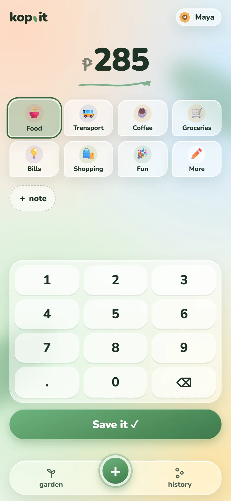
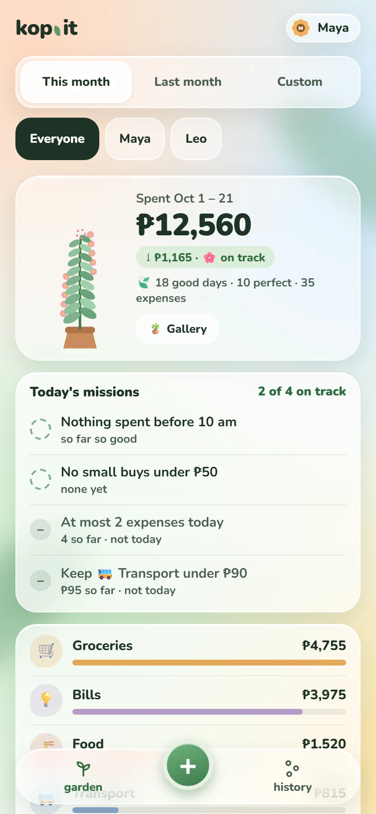
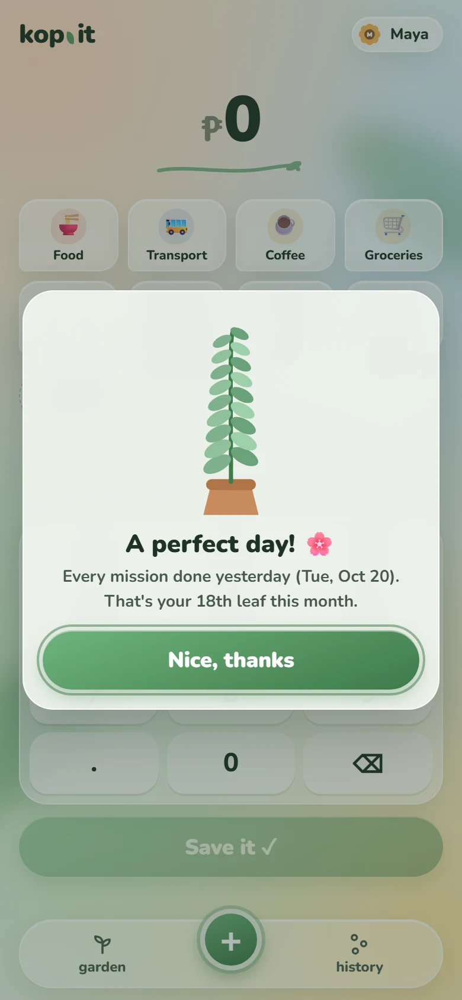
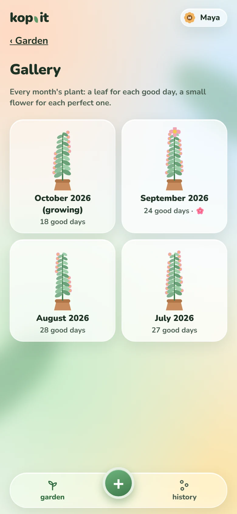
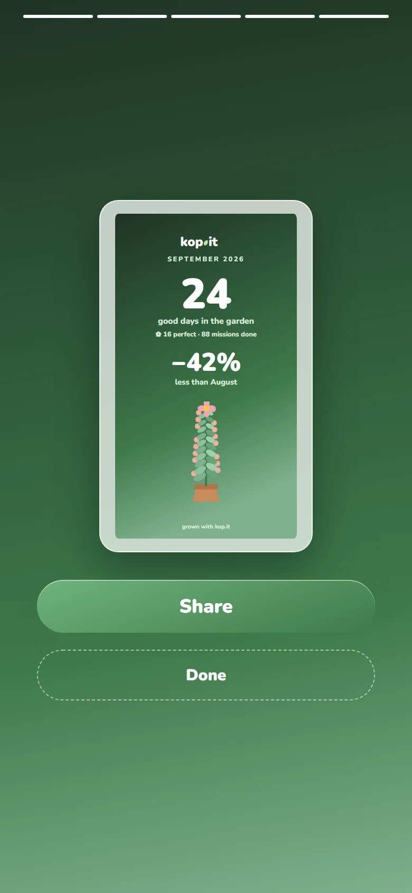
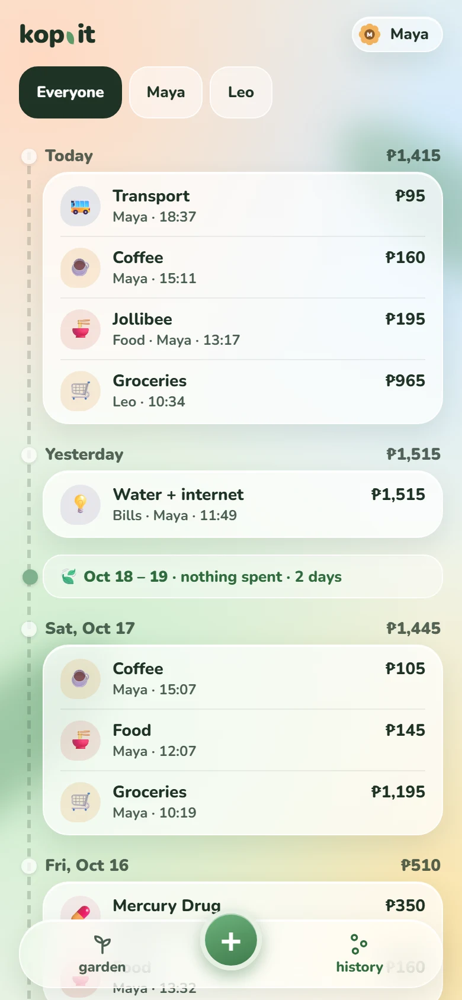

# kop.it

A small expense tracker for a household, with a money garden. Everyone logs what they spend from their own phone, and the garden screen shows where the money went.

Logging an expense takes a few seconds: type the amount, tap a category if you like, press **Save**. It works without signal too. The expense is kept on the phone and sent the next time kop.it opens online.

<table>
  <tr>
    <td align="center" width="33%"> <b>Log it in seconds</b> Keypad, category tiles, an optional note. Works offline.</td>
    <td align="center" width="33%"> <b>The garden</b> Where the money went, your pace against last month, and today's missions.</td>
    <td align="center" width="33%"> <b>A leaf for a good day</b> Yesterday's result greets you on the add screen.</td>
  </tr>
  <tr>
    <td align="center"> <b>Gallery</b> Every month's plant. A cheaper month than the last one blooms.</td>
    <td align="center"> <b>Wrapped</b> A month's recap as story slides, with a card to share.</td>
    <td align="center"> <b>History</b> Every expense by day, with no-spend days called out.</td>
  </tr>
</table>

Screenshots use a made-up demo household.

## What's in it

- Quick add screen with a number keypad, category tiles and an optional one-line note
- Garden screen with totals per category and your pace against last month
- A money garden: every day the household gets 3–5 small "spend less" missions, checked automatically from what you log. Meet at least half and the plant grows a leaf; meet them all and the leaf gets a small flower. A month that ends lower than the one before blooms. It only ever rewards, never scolds
- A gallery of every month's plant, and a Wrapped recap when a month ends
- History of every expense, newest first, grouped by day, with a filter by person
- One household, several people. Each phone picks who it belongs to
- Installs to the home screen like an app

## Putting it on your phone

- **Android (Chrome):** open the kop.it URL, then menu → **Install app**.
- **iPhone (Safari):** open the URL, then **Share → Add to Home Screen**. Open kop.it from the new icon and log in there once. iOS keeps the home-screen app's login separate from Safari's.

After the first login, pick who the phone belongs to. The login lasts a year.

iPhones don't sync in the background, so expenses saved offline are sent when you next open the app.

## Good to know

- Amounts are in pesos, up to ₱1,000,000 per expense. Dates follow Manila time.
- A wrong PIN 5 times in a row locks the household for 15 minutes. You can change the PIN in the **garden shed** (tap your name at the top) → **Change PIN**.
- Adding a new category needs internet. Saving an expense doesn't.
- One deployment holds at most 15 households.

## Running your own

Local setup, tests, deploying, backups and PIN resets are in [CONTRIBUTING.md](CONTRIBUTING.md).
