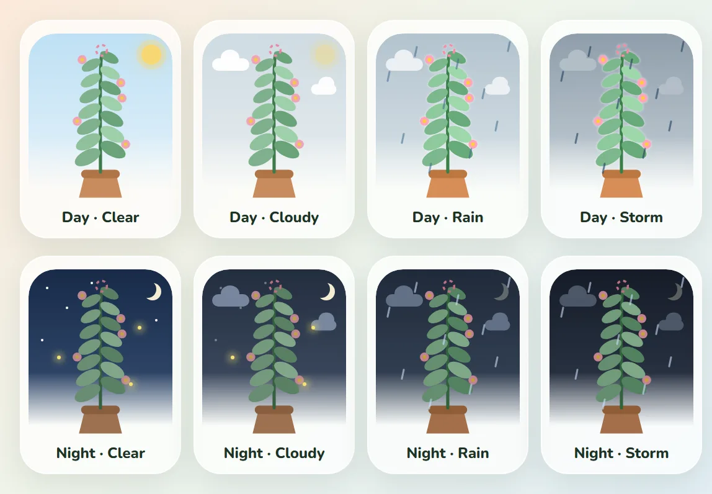

# kop.it

A small expense tracker for a household, with a money garden. Everyone logs what they spend from their own phone, and the garden screen shows where the money went.

Logging an expense takes a few seconds: type the amount, tap a category if you like, press **Save**. It works without signal too. The expense is kept on the phone and sent the next time kop.it opens online.

<table>
  <tr>
    <td align="center" width="33%"> <b>Log it in seconds</b> Keypad, one tap to pick a category, an optional note. Works offline.</td>
    <td align="center" width="33%"> <b>The garden</b> Where the money went, your pace against last month, and today's missions.</td>
    <td align="center" width="33%"> <b>A leaf for a good day</b> Yesterday's result greets you on the add screen.</td>
  </tr>
  <tr>
    <td align="center"> <b>Gallery</b> Every month's plant. A cheaper month than the last one blooms.</td>
    <td align="center"> <b>Wrapped</b> A month's recap as story slides, with a card to share.</td>
    <td align="center"> <b>History</b> Every expense by day, with no-spend days called out.</td>
  </tr>
</table>

Screenshots use a made-up demo household.

## What's in it

- Quick add screen with a number keypad, a category picker with your usual ones one tap away, and an optional one-line note
- The same categories for every household, based on research into how people sort their spending: seven needs (Groceries, Meals, Bills, Transport, Personal care & Health, Work & Education, Family & Relationships) and five wants (Eating out, Shopping, Fun & outings, Gifts & occasions, Vices). A lunch you have to buy at work goes under Meals, a treat under Eating out; loan payments under Bills; a haircut under Personal care & Health; drinking, smoking and gambling under Vices. Pick one and its notes slide up with a line on what goes in it: ready-made ones (Jollibee, Electricity, Grab…) after your household's own; type your own and tap Use, or skip. A category is optional
- Garden screen with totals for needs and wants, per category, and your pace against last month
- A money garden: every day the household gets 3 small "spend less" missions, two easy and one medium, checked automatically from what you log. They're only about how much you spend (never who buys, when to stop, or a day without spending), and a mission only ever names a want, never a need, and made from the household's own last 28 days: an easy one is something you'd have managed on about 9 of 10 of those days, a medium one on about 6. Meet at least half and the plant grows a leaf; meet them all and the leaf gets a small flower. A month that ends lower than the one before blooms. It only ever rewards, never scolds
- A gallery of every month's plant, three to a greenhouse shelf, a Wrapped recap when a month ends and a weekly recap every Monday (what was spent, needs against wants, where it went, the garden's days; never shared). Both play once on their own and stay in History, on each week's shelf and each month's sign, to replay any time
- This month's plant stands under today's sky: day or night, and the weather where you are (sun, clouds, rain, a thunderstorm)
- History as a greenhouse: every week is a shelf of seven pots, Monday to Sunday, under its month's hanging sign. Each pot shows how its day went (leafy for a good day, a flower for a perfect one, droopy for a missed one, a butterfly when nothing was spent) with a price tag under it. Today's receipt starts open; tap any pot to open its day, with every expense and its missions. Shelves build themselves in as they scroll into view, a week where every day grew gets fairy lights, and a filter by person
- An eye by the garden's total hides all but its first digit, like ₱1•,••• (on the garden screen and each category's page). It's set per person, so it follows them to any phone they pick themselves on. Tap it again to show the total
- One household, several people. Each phone picks who it belongs to from a shelf of everyone's flowers
- The other pages stand under the same greenhouse roof and sun, each named on a title card in thin spaced capitals like History's month signs. The first page leads with starting a garden; logging in waits just under it
- Installs to the home screen like an app
- A short tour on each screen (add, garden, history, garden shed) the first time each person opens it: the screen dims and lights up one part at a time. People who were already using kop.it get them once too, and the guide can play them again
- A guide in the app: how the plant grows, every sky, and every mission with an example. Privacy policy and terms sit next to it

## The garden's sky

This month's plant on the garden screen stands under the sky where you are right now.

- **Day or night** follows the real sunrise and sunset. Nights bring a moon, stars and a few fireflies.
- **Cloudy:** clouds drift past and the sun fades. **Rain:** drops fall and the leaves look wet. **Storm:** heavier rain, a gusty sway and the odd lightning flash.
- The weather comes from [Open-Meteo](https://open-meteo.com), a free weather service built on national forecasts. The phone asks it every 30 minutes, sending only a rounded location (about a kilometre).
- Location is asked for once. Say no, or have no signal, and the sky stays clear and follows the clock (6 AM to 6 PM is day).
- Past months and the gallery keep a plain plant. With reduced motion on, the sky holds still.

## Putting it on your phone

- **Android (Chrome):** open the kop.it URL, then menu → **Install app**.
- **iPhone (Safari):** open the URL, then **Share → Add to Home Screen**. Open kop.it from the new icon and log in there once. iOS keeps the home-screen app's login separate from Safari's.

After the first login, pick who the phone belongs to. The login lasts a year.

iPhones don't sync in the background, so expenses saved offline are sent when you next open the app.

## Good to know

- Amounts are in pesos, up to ₱1,000,000 per expense. Dates follow Manila time.
- A wrong PIN 5 times in a row locks the household for 15 minutes. You can change the PIN in the **garden shed** (tap your name at the top) → **Change PIN**.
- To delete the whole household, go to the very bottom of the garden shed → **Delete household…**. It asks for the PIN and for DELETE to be typed, then erases every person, expense and leaf and logs out every phone. The database's restore history keeps a copy for up to 30 days.
- The garden's sky asks for your location once, to show the weather where you are. Only a rounded location (about a kilometre) goes to [Open-Meteo](https://open-meteo.com) for the forecast. Say no and the sky just follows day and night.
- One deployment holds at most 15 households.

## Help and contributing

Found a problem or have an idea? [Open an issue](https://github.com/pur3coff33/kopit/issues). Security problems go [privately](https://github.com/pur3coff33/kopit/security/advisories/new) instead (see [SECURITY.md](SECURITY.md)). Pull requests are welcome; [CONTRIBUTING.md](CONTRIBUTING.md) has the setup.

## Running your own

Local setup, tests, deploying, backups and PIN resets are in [CONTRIBUTING.md](CONTRIBUTING.md).
